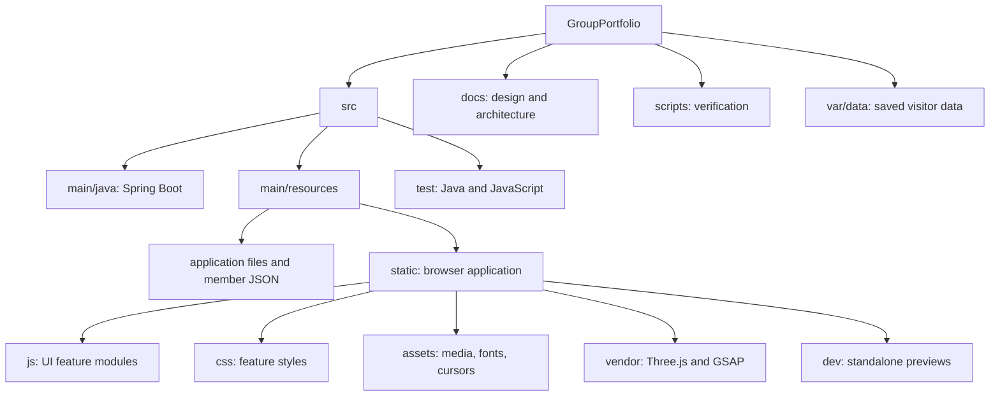
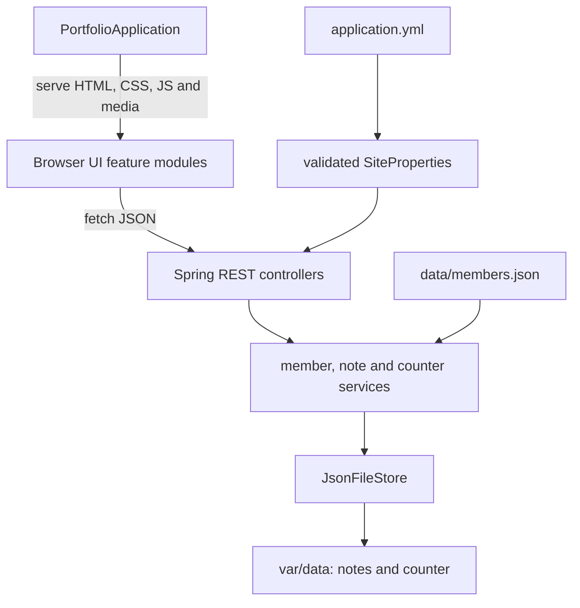

# Code layout

## Repository organization

- Maven's standard Java/resource/test structure is preserved.
- Build/deployment files stay at the root so Maven and Docker work normally.
- Generated `target/` and `.verification/` directories are ignored by Git.
- The older nested working copy was moved to `C:\workspace\GroupPortfolio-backup-d4625ae`. Its files and Git history were preserved.

## How Spring connects to the UI

- `@SpringBootApplication` starts the application and discovers components.
- `@RestController` maps HTTP routes to Java functions and JSON responses.
- Constructor injection connects controllers, services, `ObjectMapper`, and `JsonFileStore`.
- `@ConfigurationProperties("site")` binds and validates classroom settings.
- `@PostConstruct` restores member and visitor data after dependency injection.
- Browser animations, camera movement, cursor rendering, and page turns execute in JavaScript/CSS. Spring supplies content and assets.

## Browser feature ownership

| Folder under `static/js/` | Main files | Responsibility |
| --- | --- | --- |
| `core/` | `main.js`, `api.js` | Startup requests, component wiring, Back/Escape, mute, REST calls |
| `classroom/` | `scene.js`, `experiences.js`, `whiteboard.js` | Room, camera, props, whole-classroom Zero-G, characters, performance, drawing |
| `portfolio/` | `book.js`, `folder-art.js`, `themesong.js`, `handwriting.js`, `sketches.js` | Four portfolio presentations, page turns, shared folder artwork, music, doodles |
| `phone/` | `phone.js` | Phone shell, SpotiBai, Labibi, and local media UI |
| `intro/` | `intro.js`, `introSound.js` | Opening timeline and synthesized sound cues |
| `shared/` | `theme.js`, `humor.js` | Cartoon palette/materials, effects, jokes, and shared sound helpers |

- `index.html` loads vendor libraries first, shared helpers next, feature classes next, and `core/main.js` last.
- These are ordered classic browser scripts. Folder grouping does not introduce a bundler or change the API contract.
- `portfolio/folder-art.js` is shared by the 3D folder and standalone book preview, so the preview no longer needs the whole classroom scene.
- `css/cursor.css` references the 48 px arrow and 52 px glove SVGs under `assets/cursors/`. Text fields retain a text caret.

## Backend package ownership

| Package | Purpose |
| --- | --- |
| `config/` | Validated classroom, theme, intro, student, phone, and media settings |
| `controller/` | HTTP routing and status codes for members, classroom, notes, visits, and optional media |
| `service/` | Member loading, note validation, counter operations, and cache coordination |
| `storage/` | Configurable file location, legacy-data import, and temporary-file replacement |
| `model/` | Member, page, skill, note, and theme-song JSON shapes |

## Zero-G implementation

- `groupFloatingObjects()` keeps multi-part fixtures and their invisible hit targets in a shared assembly.
- `getFloatingObjects()` gathers the desk, people, chairs, bags, displays, curtains, fans, wrappers, basketball, banner, and visible character actors. The floor, walls, ceiling, and outside view remain fixed.
- `snapshotAntiGravityHomes()` saves transforms/material state before lift-off.
- `triggerAntiGravity()` animates the selected assemblies, with reduced movement for reduced-motion users.
- `stopAntiGravity()` lands them; `finishAntiGravityReset()` copies exact original poses, including when toggled rapidly.
- Starting an object interaction restores its original pose before the next camera/prop animation.
